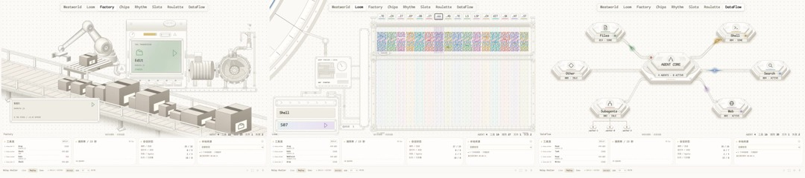

# Relay Atelier

Relay Atelier 是在本机观察 Coding Agent 工具调用的桌面程序。继续在原来的终端或客户端使用 Agent，观察器会把会话里的开始、等待、完成和失败转成机械动作。没有会话时，可以直接切到 Demo。

**桌面版下载**提供 macOS 和 Windows 的 ARM64、x64 压缩包。当前公开版本 **v1.2.0** 对应应用构建 **1.3.0**。完整解压到可写目录后打开应用。[GitHub Releases](https://github.com/NoctisWang528/RelayAtelier/releases/latest) · [版本编号与构建对应表](docs/VERSIONING.md)

[](examples/three-scenes.mp4)

[观看 1.1.0 的 50 秒运行录像](examples/three-scenes.mp4)。Factory、Loom 和 DataFlow 依次回放同一份合成样例，每次都有 48 次调用、4 个 Agent。1.1.1 更新了织机铭牌、箱体印记和风扇正视图。

## 启动当前源码

首次从公开仓库获取源码，执行 `git clone https://github.com/NoctisWang528/RelayAtelier.git`，然后进入 `RelayAtelier` 目录。已有本地副本可以直接在项目根目录执行下列命令。本机验证环境为 macOS Apple silicon、Node.js 26.7.0 和 npm 11.19.0。OpenCode 适配器使用 Node.js 内置的 `node:sqlite`，依赖版本以 `package-lock.json` 为准。

```sh
npm ci
npm start
```

- **已用 npm start 初始化 Electron 的 Mac 工作目录**可直接在 Finder 双击 [源码启动器](scripts/start-source.command)。
- **Windows 源码**使用相同的两条 npm 命令。当前源码窗口已在 macOS 验证，Windows 真机运行仍待验证。
- **浏览器入口**为 `npm run web`。打开终端打印的完整本地链接。按 Ctrl+C 停止。默认端口为 4317，遇到占用自动选择空闲端口。
- `scripts/start.command` 和 `scripts/start.bat` 会优先打开本机已有的旧包。项目中如有 `release/`，其中的 1.1.0 对应较早的视觉版本。当前源码启动入口见上。

首次使用可以选 **Demo → Factory** 看取料、放料和出带，再切到 **Loom** 看同一批调用怎样织入布面。要观察自己的 Agent，切到 **Live**，在右下角“本地来源”查看连接详情和最近真实事件。历史排演用 **Replay**。[使用手册与故障排查](docs/USAGE.md)

当前源码支持 **21 个 Agent 来源**。点击底部工具栏右侧的 **设置**，即可逐项勾选要采集的 Agent、添加自定义会话目录、选择自动／浅色／深色外观，以及调整帧率上限。桌面版会自动检查 GitHub 正式发行版，发现新版后可打开下载页。[支持清单、默认路径与文件格式](docs/SOURCES.md#agent-session-locations)

需要更快看到工具活动时，在桌面窗口打开 **本地来源 → Agent Hooks**，选择对应 Agent 安装。回调唤醒本机会话读取，事件配对、失败判定和最近事件时间仍取自会话记录。面板也提供移除入口。[Hook 安装、恢复与扩展](docs/HOOKS.md)

## 场景

| 场景 | 一次工具调用在画面上的表现 |
| --- | --- |
| Westworld | 转盘带阻尼地定位到工具扇区，指示灯、管线和玻璃容器随事件响应。 |
| Loom | 16 块工具铭牌随窗口宽度排成多行，每块通过彩线连接到自己的经线。较长的操作名分行显示，悬停可见完整名称及同槽工具。 |
| Factory | 双爪取箱放上主带。每箱的端面运单和近侧印记标识工具，队列中的箱子沿传送带推进，右侧风扇绕固定轴心转动。 |
| Chips | 工具卡从牌靴送出、落桌，后续状态更新原卡和筹码反馈。 |
| Rhythm | 工具标记沿各自轨道抵达判定线，触发光效。计分和连击仅描述演出。 |
| Slots | 工具转轮按调用顺序停轮，气压装置响应。 |
| Roulette | 小球入轨，转轮减速落槽并显示工具反馈。 |
| DataFlow | 核心与工具节点之间传送脉冲，等待在节点停留，失败以红色返回。实际父子关系驱动分支。 |

## 支持的 Agent 与默认会话位置

表中 `~` 表示用户主目录（Windows 为 `%USERPROFILE%`）。`<应用数据>` 在 macOS 为 `~/Library/Application Support`，在 Windows 为 `%APPDATA%`。设置 `XDG_DATA_HOME` 后，表中的 `~/.local/share` 使用该路径。

| Agent | 默认会话目录或数据库 |
| --- | --- |
| Cherry Studio Agents | `<应用数据>/CherryStudio/Data/Agents/.claude/projects`<br>`<应用数据>/CherryStudio/.claude/projects` |
| Claude Code | `~/.claude/projects` |
| Cline | `<应用数据>/Code/User/globalStorage/saoudrizwan.claude-dev/tasks`<br>`~/.cline/data/sessions`<br>`~/.cline/data/tasks` |
| CodeBuddy Code | `~/.codebuddy/projects` |
| Codex | `~/.codex/sessions` |
| DeepSeek Harness | `~/.dsh/sessions` |
| Factory Droid | `~/.factory/sessions` |
| Gemini CLI | `~/.gemini/tmp` |
| GitHub Copilot CLI | `~/.copilot/session-state` |
| Kilo Code | `~/.local/share/kilo/kilo.db`<br>`<应用数据>/Code/User/globalStorage/kilocode.kilo-code/tasks` |
| Kimi CLI / Code | `~/.kimi/sessions`<br>`~/.kimi-code/sessions`<br>`<应用数据>/kimi-desktop/daimon-share/daimon/runtime/kimi-code/home/sessions` |
| MiMo Code / Desktop | `~/.local/share/mimocode/mimocode.db`<br>macOS `<应用数据>/orca/mimocode-hooks/shared/data/mimocode.db` |
| Oh My Pi | `~/.omp/agent/sessions` |
| OmO Native / SenPi | `~/.senpi/agent/sessions`<br>`~/.omo/agent/sessions`<br>`~/.omo/senpi-task/children` |
| OpenClaw | `~/.openclaw/agents` |
| OpenCode | `~/.local/share/opencode/opencode.db` |
| Pi | `~/.pi/agent/sessions` |
| Proma | `~/.proma/sdk-config/projects`<br>`~/.proma/sdk-config/sessions`<br>`~/.proma-dev/sdk-config/projects`<br>`~/.proma-dev/sdk-config/sessions` |
| Qwen Code | `~/.qwen/projects` |
| Reasonix | macOS `~/.reasonix/sessions`<br>macOS `~/.reasonix/projects/*/sessions`<br>Windows `<应用数据>/reasonix/sessions`<br>Windows `<应用数据>/reasonix/projects/*/sessions` |
| WorkBuddy | `~/.workbuddy/projects`<br>`~/.workbuddy-ai/projects` |

## 项目文档

| 要完成的事情 | 入口 |
| --- | --- |
| 安装、选会话、处理空闲与连接问题 | [使用手册](docs/USAGE.md) |
| 理解只读来源、窗口通信、调度与渲染 | [架构说明](docs/ARCHITECTURE.md) |
| 编写适配器、判断何时可以报告成功 | [事件规范](docs/EVENTS.md) |
| 安装可选 Hook 或接入新的 Agent | [Hook 规范](docs/HOOKS.md) |
| 开发、运行测试、提交本地改动 | [开发与贡献指南](CONTRIBUTING.md) |
| 查找各场景的研究与历次验证 | [文档索引](docs/README.md) |

本项目源码采用 [MIT 许可证](LICENSE)。字体和参考资料的来源及许可分别列在 [第三方声明](THIRD_PARTY_NOTICES.md)。
