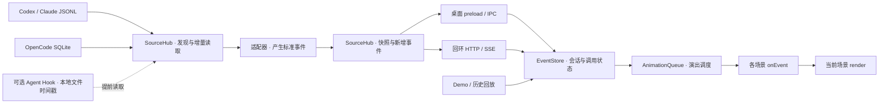

# 运行架构

Relay Atelier 有两个运行入口。Electron 主进程和本地 HTTP 服务各自创建一个 `SourceHub`，共用来源适配器、状态模型和 Canvas 场景。桌面窗口从项目文件加载界面，无需另起 HTTP 服务。

## 模块职责

| 模块 | 读写边界 |
| --- | --- |
| [server/hub.mjs](../server/hub.mjs) | 发现来源、维护文件偏移和 SQLite 连接、驱动适配器、合并父子关系。提供 `start()`、`snapshot()`、`stop()` 和 `event`、`status` 通知。 |
| [server/adapters.mjs](../server/adapters.mjs) | 从各来源的工具记录提取调用、状态与有限目标标识。原始记录只在本地解析。 |
| [desktop/main.cjs](../desktop/main.cjs)、[preload.cjs](../desktop/preload.cjs) | 创建可缩放的单实例窗口，管理置顶和可见性。preload 向沙箱页面提供快照与订阅，渲染进程关闭 Node 集成并开启上下文隔离。 |
| [server/web.mjs](../server/web.mjs) | 为浏览器和自动测试提供本地静态资源、快照和事件流。 |
| [src/state.mjs](../src/state.mjs) | `EventStore` 先检查并记账。`AnimationQueue` 单独调节事件呈现速度。 |
| [src/app.mjs](../src/app.mjs) | 管理来源模式、会话选择、快照补读、播放时钟、视口、导航和无障碍标签。 |
| [src/scenes](../src/scenes/) | 每个场景独立实现 `onEvent(event, t)` 和 `render(ctx, t, dt, state)`，按类别复用机械绘图、颜色或运动学辅助函数。 |

## 从一次调用到画面

以一次文件读取为例。适配器先产生带有 `callId` 的 `started` 事件。Hub 将其放入快照窗口，符合实时条件时额外广播。渲染端确认该过渡尚未处理，写入调用状态，再将事件放入演出队列。

释放队列事件时，所有场景实例都接收这一过渡，只有当前可见场景绘制。Factory 可以安排一个箱体，Loom 可以安排一行织物。结果抵达时，事件 ID 改变，调用 ID 保持一致；计数仍为一次。用户切到另一个场景时，它已收到同一批过渡。切换来源模式或会话筛选会重建演出状态。Live 可从所选历史恢复静态铭牌。

## 快照、实时通知与恢复

- Hub 默认约每 1200 毫秒轮询一次，同一实例串行执行读取。首次读取或来源恢复时先填充历史和状态。已连接来源的新记录还需满足启动时间边界，才进入实时通知。
- 默认桌面与 Web 来源还以 180 毫秒间隔检查空文件 `~/.relay-atelier/hooks/pulse` 的修改时间。已注册的 Hook 触发后，Hub 将刷新合并到串行读取中。单独构造带 `roots` 的 Hub 默认隔离真实信号，可通过 `pulseFile` 注入测试文件。任何绘图事件仍需通过来源适配器验证。
- JSONL 按字节偏移读取，以完整行解码。文件轮转、截断和未写完的 UTF-8 行都有专门处理。默认每个 JSONL 来源最多选择最近修改的 64 个文件。
- OpenCode 连接采用 `readOnly: true`。Hub 检查实际表结构，在 `PRAGMA data_version` 改变时通过读事务处理工具记录，包括可见的 WAL 更新。
- Web 端用 `GET /api/snapshot` 获取初始状态，`GET /api/events` 收到 `tool` 和 `status` 两类 SSE 通知。重连时补读快照，应用也周期性重新同步。快照可恢复的范围取决于保留窗口。
- Electron 的 `window.relay` 提供 `snapshot()`、`onEvent()`、`onStatus()`、`onVisibility()`、`pin()` 和 `windowInfo()`。进程内读源，页面只通过这些入口交互。
- 桌面主进程另外向本地页面开放 `hooks.list()`、`hooks.install(id)` 和 `hooks.remove(id)`。实际配置路径和可执行内容均由主进程中的 provider 决定。Web 服务维持只读接口。[Hook 规范](HOOKS.md)

## 容量与时钟

| 位置 | 当前限制 | 对用户的影响 |
| --- | --- | --- |
| Hub 快照 | 最近 4000 个状态过渡 | 单次调用可有多个过渡。重启或长时间断开后，历史有边界。 |
| 前端状态 | 默认保留 6000 次调用，近期事件列表至多 100 条 | 会话统计针对已保留的数据。后端去重与配对索引另有生命周期。 |
| 演出队列 | 默认 240 个待演事件 | 满载时优先折叠相同工具类别、状态与 Agent 的事件，无法合并时丢弃最早的待演事件。逻辑状态已先行写入。 |
| 绘制 | 逻辑画布宽 1200，按窗口适配高度，像素密度上限 2 | 事件活跃时目标 60 fps，空闲约 12 fps；减少动态效果目标 10 fps，暂停时约 2 fps。隐藏时停止场景绘制。 |

`timestamp` 使用事件的真实时间。`t` 与 `dt` 使用演出时钟的秒数，供阻尼、出带、落牌及拖尾计算。暂停、回放压缩和积压折叠均会改变视觉时间，用录像测得的动作间隔不能用作 Agent 耗时指标。

## 本地服务访问

浏览器服务仅绑定 `127.0.0.1`，校验 Host 和已提供的 Origin。首次打开终端给出的完整链接后，服务发放本次进程的 HttpOnly、SameSite=Strict Cookie 并重定向到根路径。静态文件按类型和路径白名单提供。实际会话文件、数据库、项目文档和验证输出均不在静态资源白名单内。关闭服务后重新启动，会产生新的访问令牌。
